<picture>
  <source media="(max-width: 640px)" srcset="assets/hero-mobile.svg">
  
</picture>

我是 **wshy**，2014 年加入 GitHub。做 A 股量化工具，也做 AI 工具链与插件。

偏好自托管、开放接口和本地数据。把自己用得上的东西做好，再分享给需要的人。

## 作品集

<a href="https://github.com/shy3130/tick-stock-panel">
<picture>
  <source media="(max-width: 640px)" srcset="assets/feature-mobile.svg">
  
</picture>
</a>

[项目源码](https://github.com/shy3130/tick-stock-panel) · [访问官网](https://tsp.shy313.com) · 

### AI 与开发者工具

<a href="https://github.com/shy3130/dsh-quota">
<picture>
  <source media="(max-width: 640px)" srcset="assets/dsh-mobile.svg">
  
</picture>
</a>

<a href="https://github.com/shy3130/zcode-tps-monitor">
<picture>
  <source media="(max-width: 640px)" srcset="assets/zcode-mobile.svg">
  
</picture>
</a>

<a href="https://github.com/shy3130/codex-token-monitor">
<picture>
  <source media="(max-width: 640px)" srcset="assets/codex-mobile.svg">
  
</picture>
</a>

<a href="https://github.com/shy3130/stealth-browser-skill">
<picture>
  <source media="(max-width: 640px)" srcset="assets/browser-mobile.svg">
  
</picture>
</a>

技术栈与贡献轨迹

Python · TypeScript · React · FastAPI · Polars · DuckDB · Docker · GitHub Actions

<picture>
  <source media="(prefers-color-scheme: dark)" srcset="assets/contrib-dark.svg">
  
</picture>

近 52 周贡献快照 · 2026-11-09 · 红涨绿跌；最新贡献见 GitHub 原生贡献图。

## 支持开源

持续维护得到 [RunningHub API](https://www.runninghub.ai/zh-cn/call-api/llm/models?source=github&inviteCode=edt5wh7c) 的支持。

如果这些项目对你有帮助，欢迎在 [爱发电](https://afdian.com/a/shy3130) 支持我继续做点有用的东西。

---

wshy · 写代码。做开源。造工具。

