## 💜 支持与赞助

我的开源项目由 [RunningHub](https://www.runninghub.ai/zh-cn/call-api?source=github&inviteCode=edt5wh7c) 提供支持 · 单一接口直连 400+ 主流大模型 · 免费测试

  

如果 tick-stock-panel 对你有帮助，欢迎到爱发电支持我 ☕

## 🚀 tick-stock-panel · A 股智能量化工作台

  
  
  
  
  
  
  

<table>
<tr>
<td align="center"><b>65</b> 开放 API 端点</td>
<td align="center"><b>12</b> MCP 工具</td>
<td align="center"><b>6</b> Token 权限档</td>
<td align="center"><b>2400+</b> 测试全绿 · CI 守护</td>
<td align="center"><b>ms 级</b> 全市场策略扫描</td>
<td align="center"><b>1 容器</b> 零外部数据库</td>
</tr>
</table>

<table>
<tr>
<td width="50%" valign="top"><b>🧭 策略 · 回测</b> 自建策略 + 历史回放验证，Polars 引擎 ms 级全市场扫描</td>
<td width="50%" valign="top"><b>📡 实时监控</b> 个股异动与策略信号盯盘，实时推送提醒</td>
</tr>
<tr>
<td valign="top"><b>🧪 因子挖掘</b> 因子研究与挖掘，数据源插件化 · 自由接入第三方数据</td>
<td valign="top"><b>🤖 AI 助手 · LLM 驱动</b> 大模型驱动策略定制、个股分析与复盘</td>
</tr>
<tr>
<td colspan="2" valign="top"><b>🌐 开放能力</b> · Open API 全端点开放 · MCP 接入 · 6 档 Token 权限 · 单容器部署零运维</td>
</tr>
</table>

⚠️ 仅供学习研究 · 不作为投资或看盘软件 · 不做 AI 荐股与涨停预测

  

## 👋 关于我

<table>
<tr>
<td width="70%" valign="middle">

- 🏦 **A 股量化交易开发者** —— [**tick-stock-panel**](https://github.com/shy3130/tick-stock-panel) 作者，**5.9k Stars · 1.4k Forks**
- 🤖 **LLM 深度实践者** —— 把核心能力全部开放成 Open API 与 MCP 工具
- 🐍 **2014** 年加入 GitHub，常年高频贡献 · 现已入驻 [**爱发电**](https://afdian.com/a/shy3130)

</td>
<td width="30%" valign="middle" align="center">

</td>
</tr>
</table>

## 🧩 其他项目

<table>
<tr>
<td>

**[zcode-tps-monitor](https://github.com/shy3130/zcode-tps-monitor)** — ZCode 会话级 Token 速率监控插件：每轮回复末尾显示真实 tok/s（读取 usage 数据库），附实时监控大屏 · `/tps` 命令 · MCP 工具

</td>
<td width="140" align="center" valign="middle">

</td>
</tr>
<tr>
<td>

**[stealth-browser-skill](https://github.com/shy3130/stealth-browser-skill)** — AI Agent 反检测浏览器自动化技能（Anti-detection browser automation skill for AI agents）

</td>
<td width="140" align="center" valign="middle">

</td>
</tr>
</table>

## 🛠 技术栈

<table>
<tr>
<td width="130" valign="middle"><b>语言</b></td>
<td valign="middle"></td>
</tr>
<tr>
<td valign="middle"><b>后端 · 数据</b></td>
<td valign="middle"></td>
</tr>
<tr>
<td valign="middle"><b>前端</b></td>
<td valign="middle"></td>
</tr>
<tr>
<td valign="middle"><b>工具链</b></td>
<td valign="middle"></td>
</tr>
</table>

## 📊 GitHub 数据

  
  &nbsp;
  

  

  <picture>
    <source media="(prefers-color-scheme: dark)" srcset="https://raw.githubusercontent.com/shy3130/shy3130/output/github-snake-dark.svg" />
    <source media="(prefers-color-scheme: light)" srcset="https://raw.githubusercontent.com/shy3130/shy3130/output/github-snake.svg" />
    
  </picture>

 

  

