<picture>
  <source media="(prefers-color-scheme: dark)" srcset="assets/hero-dark.svg">
  
</picture>

独立开发者，2014 年入驻 GitHub。长期做 A 股量化工具与 LLM 工具链 —— 偏好自托管、可编程，喜欢把核心能力开放成接口，不喜欢把工具做成黑盒。

## 01 — 精选作品

### [tick-stock-panel](https://github.com/shy3130/tick-stock-panel)

自托管、零运维的 A 股量化工作台。策略编写与历史回放、全市场毫秒级扫描、实时盯盘、因子挖掘，以及 LLM 驱动的个股分析与复盘。核心能力全部开放为 Open API 与 MCP 工具。

`Python` `FastAPI` `React` `TypeScript` `Polars` `DuckDB`

65 个开放 API · 12 个 MCP 工具 · 2400+ 测试 · 单容器部署 · [官网 tsp.shy313.com](https://tsp.shy313.com)

## 02 — 开源项目

| 项目 | 说明 |
| --- | --- |
| [codex-token-monitor](https://github.com/shy3130/codex-token-monitor) | Codex 本地用量与性能监控：Token 消耗、平均 TPS 与 API 参考费用 |
| [dsh-quota](https://github.com/shy3130/dsh-quota) | DeepSeek Harness 多厂商额度监控插件：GLM / Kimi / DeepSeek 余额与消耗 |
| [zcode-tps-monitor](https://github.com/shy3130/zcode-tps-monitor) | ZCode 会话级真实 tok/s 监控，附实时监控大屏与 MCP 工具 |
| [stealth-browser-skill](https://github.com/shy3130/stealth-browser-skill) | 面向 AI Agent 的反检测浏览器自动化技能 |

## 03 — 技术栈

Python · TypeScript · Polars · FastAPI · React · DuckDB · Docker · GitHub Actions

## 04 — 支持

持续维护由 [RunningHub API](https://www.runninghub.ai/zh-cn/call-api/llm/models?source=github&inviteCode=edt5wh7c) 提供支持：单一接口接入 400+ 主流大模型，注册即赠体验额度。

如果 [tick-stock-panel](https://github.com/shy3130/tick-stock-panel) 对你有帮助，欢迎在 [爱发电](https://afdian.com/a/shy3130) 请我喝一杯。

---

写代码 · 做开源 · 造工具

